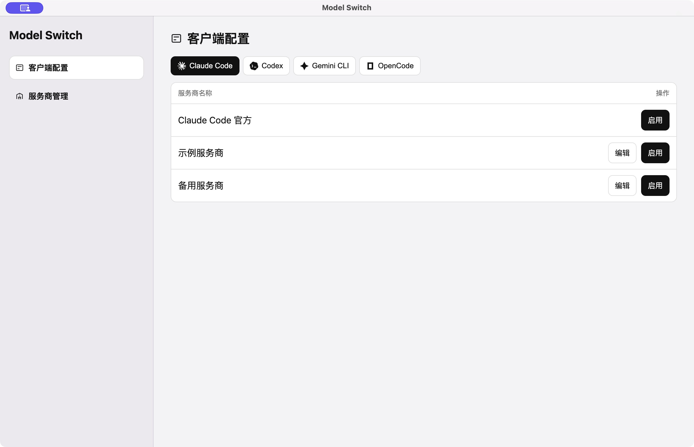
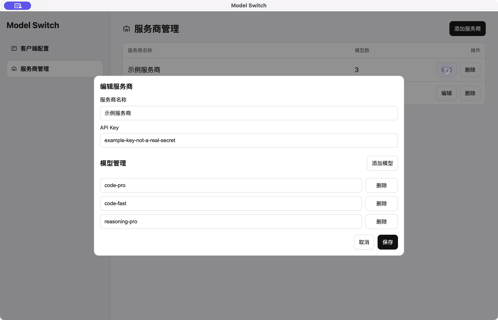

<p align="center">
  
</p>

<h3 align="center">Model Switch</h3>

<p align="center">
  <strong>Switch models and providers across your AI coding tools</strong>
</p>

<p align="center">
  <a href="README.md">简体中文</a> · <strong>English</strong>
</p>

## Why build this tool?

1. **More tools mean more scattered settings.** Claude Code, Codex, Gemini CLI, and OpenCode each have their own configuration format. Adding the same provider and models across multiple tools often means entering and maintaining the same information repeatedly.
2. **Switching models interrupts your work.** Different tasks call for different models, and you may also need to change providers. Finding configuration files and editing endpoints and keys by hand takes time and makes mistakes easy.

## What Model Switch offers

### 1. Multiple AI coding tools, one window

Manage provider and model settings for Claude Code, Codex, Gemini CLI, and OpenCode in one place. Each tool can use its own provider. Configure it, then click Enable to switch, or choose Official to return to the tool's built-in connection method.



### 2. Shared provider management, independent model choices

Maintain provider names, API keys, and model lists centrally for use across clients. Add a preset or create a custom provider, then choose each client's endpoint and model independently.



All providers, keys, and models shown in the screenshots are demonstration data.

## How to use

### Option 1: Run from source

Install Git and [Node.js 24](https://nodejs.org/), then run:

```bash
git clone https://github.com/banwotech/model-switch.git
cd model-switch
npm ci
npm run dev
```

### Option 2: Build an installer locally

After downloading the source and installing dependencies as above, run:

```bash
npm run build
```

The generated application and installer are in `dist-electron/`. Open the appropriate file to install.

### Get started

1. Add a provider in Provider Management and enter its API key and available models.
2. Select a tool in Client Configuration and set the provider's endpoint and model.
3. Click Enable, then use the corresponding coding tool.

Enabling a configuration, or editing one that is active, updates the corresponding tool's local configuration. Back up your existing configuration first. Gemini CLI currently uses zsh configuration on macOS or Linux environments running zsh; use a new terminal after switching.

## License

This project uses the [PolyForm Noncommercial License 1.0.0](LICENSE). Use and distribution are subject to its terms.
