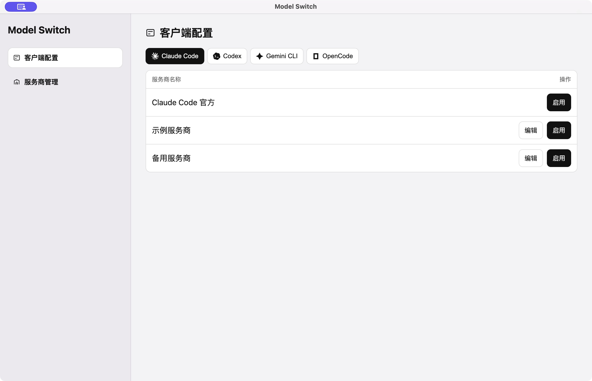
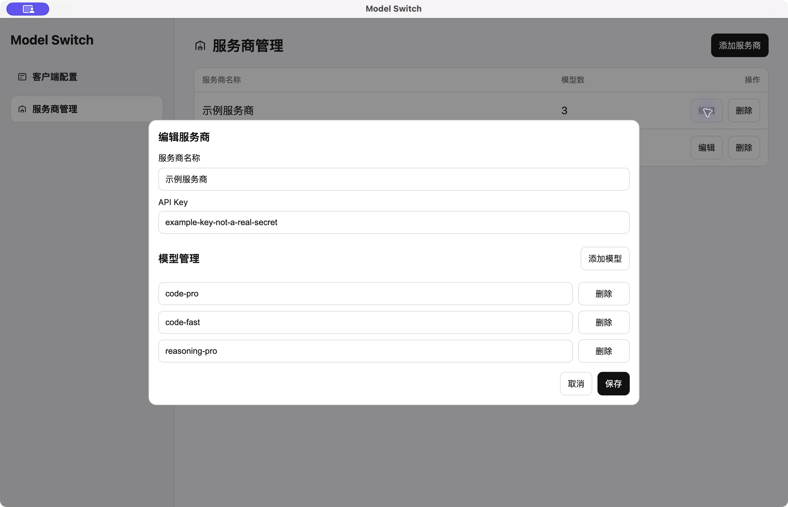

<p align="center">
  
</p>

<h3 align="center">Model Switch</h3>

<p align="center">
  <strong>为 AI 编程工具而生的模型与服务商切换软件</strong>
</p>

<p align="center">
  <strong>简体中文</strong> · <a href="README.en.md">English</a>
</p>

## 为什么做这个工具

1. **工具越来越多，配置各自分散。** Claude Code、Codex、Gemini CLI、OpenCode 各有自己的配置方式。同一个服务商和模型，在不同工具中往往要重复填写，维护起来很麻烦。
2. **想换个模型，却要反复改配置。** 不同任务适合不同模型，服务商也可能需要切换。手动查找配置文件、修改地址和密钥，既打断工作，也容易填错。

## Model Switch 的优势

### 1. 多款 AI 编程工具，一个窗口管理

集中管理 Claude Code、Codex、Gemini CLI 和 OpenCode 的服务商与模型配置。每款工具都能独立选择服务商，配置完成后点击「启用」，即可切换；也能选择「官方」，切回工具自带的接入方式。



### 2. 服务商统一维护，模型按需选择

在「服务商管理」中统一维护名称、API Key 和模型列表，供不同客户端选用。支持从预设添加，也可以自定义服务商；各客户端的接入地址与模型分别设置，减少重复维护。



截图中的服务商、密钥和模型均为演示数据。

## 如何使用

### 方式一：下载源码运行

先安装 Git 和 [Node.js 24](https://nodejs.org/)，然后执行：

```bash
git clone https://github.com/banwotech/model-switch.git
cd model-switch
npm ci
npm run dev
```

### 方式二：本机打包安装

完成上面的源码下载与依赖安装后，执行：

```bash
npm run build
```

生成的应用和安装包位于 `dist-electron/` 文件夹，打开对应文件即可安装。

### 开始使用

1. 在「服务商管理」中添加服务商，填写 API Key 和可用模型。
2. 在「客户端配置」中选择要使用的 AI 编程工具，为服务商设置接入地址和模型。
3. 点击「启用」，随后在对应的编程工具中使用。

启用或修改正在使用的配置会更新对应工具的本地配置，使用前请先备份。Gemini CLI 当前通过 zsh 配置，适用于 macOS 或使用 zsh 的 Linux 环境，切换后请在新终端中使用。

## 许可证

本项目采用 [PolyForm Noncommercial License 1.0.0](LICENSE)，使用与分发请遵守许可证条款。
